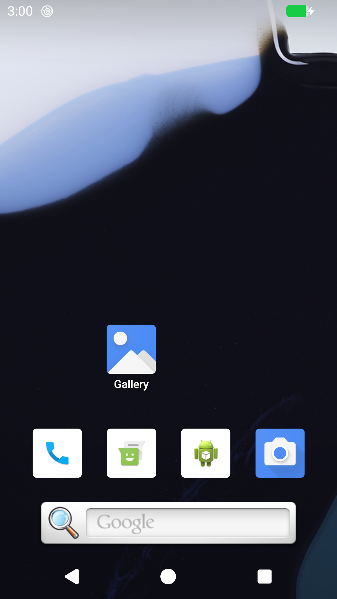
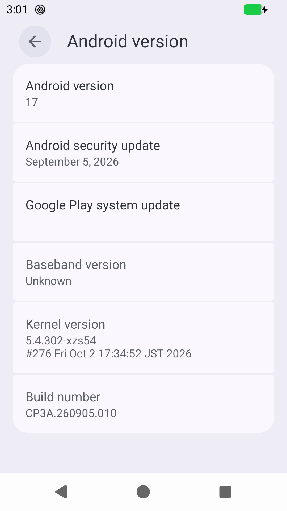
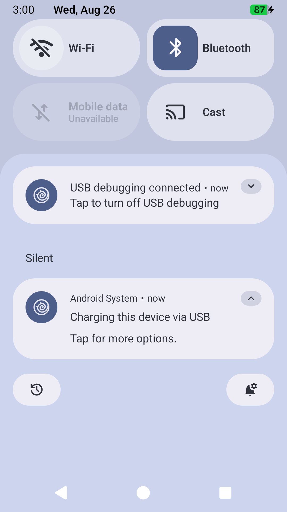

# Sony Xperia XZs (`keyaki` / `SO-03J`) — Android 17 AOSP Port

**Language**: **English (Default)** | [Tiếng Việt (README.vi.md)](README.vi.md)

Pure **Android 17 AOSP ("Cinnamon Bun", `CP3A.260905.010`, SDK 37 / API 37.1)** port, kernel integration, and reproducible image build pipeline for the **Sony Xperia XZs (`SO-03J` / `keyaki`, Qualcomm Snapdragon 820 `MSM8996`, Sony `tone` platform)**.

**Verified update — 2026-11-13:** kernel `5.4.302-g32a306e084db-dirty` build 7, two working cameras, Bluetooth preserved and Developer options crash fixed. See [the bilingual camera/Settings release notes](docs/SETTINGS_CAMERA_BRINGUP.md) for evidence, current image checksums and upgrade instructions. The final boot/OEM flash passed read-back and reboot verification. The original boot timing below belongs to the initial milestone.

> [!NOTE]
> **`oneui` Branch — Samsung One UI 6.1 (`A057FXXU8CYC6`, Android 14 / SDK 34)**: Builds a **MysticGSI One UI 6.1 (`SM-A057F`)** system image on top of this Linux `5.4.302` (`boot-a17-keyaki.img`) and `VNDK 30` (`oem-a17-keyaki.img`) foundation via [`tools/build_oneui_a05s_keyaki.py`](tools/build_oneui_a05s_keyaki.py). See [`docs/ONEUI61_PORT_GUIDE.md`](docs/ONEUI61_PORT_GUIDE.md) and [`manifests/oneui61-release-20261119.json`](manifests/oneui61-release-20261119.json) for root-cause fixes (`bpfloader` `schedcls`, `KnoxGuard` code `3010`, ConfigFS USB ADB, and BCM4359 Wi-Fi MAC randomization RRO removal) and TWRP staging/flash steps.

> [!IMPORTANT]
> **Initial Boot Milestone (`v0.1.0-android17-boot-freeze`)**: Standalone cold boot from internal eMMC to Android 17 Launcher3 Home Screen in ~38 seconds (`sys.boot_completed=1`, `0` native/framework crashes), with hardware-accelerated Adreno 530 GPU composition (`1080x1920 @ 60 Hz`), multitouch, Wi-Fi, stereo speaker audio, sensors, internal storage, and USB ADB verified on live hardware.

---

## Live Hardware Screenshots

| Launcher3 Home Screen | Android 17 Version Details | Quick Settings Shade |
| :---: | :---: | :---: |
|  |  |  |

---

## System Architecture Overview

| Layer | Version / Upstream Source | Target Partition | Technical Summary |
| :--- | :--- | :--- | :--- |
| **System (`/` / `/system`)** | Google Android 17 AOSP ARM64 GSI (`CP3A.260905.010`, SDK `37`, Security Patch `2026-09-05`, Vanilla / No GMS) | `system` (`mmcblk0p55`, `7.18 GiB`) | Resized `2.6 GiB` ext4, unshared blocks, custom signed `com.android.vndk.v30.apex`, ext4-repacked `com.android.virt.apex`, generated SELinux `30.0.cil`, Linux 5.4 BPF + `libui` Gralloc 2.0 shims |
| **Vendor (`/vendor`)** | LineageOS 18.1 Treble Vendor (`tone` / `keyaki`, VNDK `30`, VINTF level `5`) | `oem` (`mmcblk0p53`, `400 MiB`) | Mounted directly at `/vendor` in first-stage init; ships 17 Linux `5.4.302` audio DLKM modules, `brcmfmac` PCIe Wi-Fi firmware/NVRAM, ConfigFS USB gadget, and `fsverity`-enabled `fstab.keyaki` |
| **Kernel & Boot** | Linux `5.4.302-g32a306e084db-dirty (#7)` (`nec093/sov35-kernel`) + static C `keyaki_first_stage_init` | `boot` (`mmcblk0p30`, `64 MiB`) | Appended `msm8996-tone-keyaki` DTB, `S1_Boot`-compatible v0 header (`--os_version 10.0.0`), early eMMC/RPMB node population, `SwitchRoot` into `/system/bin/init` |
| **Standalone Recovery** | TWRP `3.7.0_9-0` (Linux `3.18.71`) | `FOTAKernel` (`mmcblk0p48`, `64 MiB`) | Preserved untouched as an independent recovery environment (`adb reboot recovery` or `Power + Volume Down`) |

---

## Hardware and Feature Status Matrix

### Working (Verified on Live `SO-03J` Hardware)

| Subsystem | Status | Technical Details |
| :--- | :--- | :--- |
| **Bluetooth** | `[Working]` | Owner confirmed operation; HAL and Android stack remain ON, zero crashes during the observed checks. BCM4359 UART LPM workaround is included in the vendor builder. |
| **Front & Rear Cameras** | `[Working]` | IMX400 rear / IMX258 front, IDs 0 and 1. Preview observed without tracing; owner confirmed both cameras working. Legacy media group mapping and keyaki XMLs are included. |
| **Developer Options** | `[Working]` | Settings entry-page crash fixed with narrow `logpersistd_logging_prop` permissions on the debuggable user GSI. |
| **Boot & Core OS** | `[Working]` | Standalone cold boot from `mmcblk0` in ~38s (`sys.boot_completed=1`), 45/45 APEX modules activated & verified by `PackageManagerService`, Zygote64, ART, SystemUI, Launcher3 |
| **Display & Backlight** | `[Working]` | `1080x1920 @ 60 Hz` MIPI-DSI IPS panel (`mdss_dsi_panel`), hardware VSYNC interrupts, WLED / `lcd-backlight` brightness control |
| **GPU & Composition** | `[Working]` | Qualcomm Adreno 530 (`OpenGL ES 3.2 V@415.0`), `Gralloc 2.0` (`allocator@2.0` / `mapper@2.0`), `HWComposer 2.1` hardware overlay (`DEVICE`) composition, `skiaglthreaded` RenderEngine |
| **Touchscreen & Buttons** | `[Working]` | Synaptics `clearpad` capacitive multitouch (`/dev/input/event5`), Power key (`qpnp_pon`), Volume Up/Down & two-stage Camera shutter keys (`gpio-keys`) |
| **Wi-Fi (`802.11a/b/g/n/ac`)** | `[Working]` | Broadcom `BCM4359` PCIe (`brcmfmac` driver + `somc,keyaki` NVRAM + `android.hardware.wifi@1.0-service` / `IWifi@1.4` + `wpa_supplicant`); `wlan0` enables and scans 2.4/5 GHz networks |
| **Audio (Speakers & Routing)** | `[Working]` | Qualcomm `msm8996-tasha-mtp-snd-card` (`wcd9335` codec + dual `wsa881x` stereo speakers via 17 `5.4.302` DLKM modules + `AudioFlinger` 48 kHz stereo mixer) |
| **Internal Storage & Swap** | `[Working]` | `/data` (`mmcblk0p54`, ~20.8 GiB `ext4` read/write with `quota` + `fsverity`), `/cache` (`mmcblk0p43`, 256 MiB `ext4`), `1 GiB` `zram0` swap |
| **Sensors** | `[Working]` | Bosch `BMI160` Accelerometer & Gyroscope, AKM `AK09915` Magnetometer, Avago `APDS-9940` Proximity & Ambient Light, ALPS `HSPPAD042A` Barometer/Pressure, QTI Gravity & Linear Acceleration |
| **USB & ADB** | `[Working]` | Qualcomm DWC3 USB peripheral (`6a00000.dwc3`), ConfigFS FunctionFS ADB (`0x18D1:0x4EE7`) |
| **Battery, Charging & Power** | `[Working]` | Battery capacity/voltage/temperature reporting (`android.hardware.health@2.1`), USB charging detection, `vendor.qti.hardware.perf@2.0-service` CPU governor control |
| **Hardware Crypto, DRM & TA** | `[Working]` | `qseecomd` + `/dev/mmcblk0rpmb`, `keymaster@3.0`, `gatekeeper@1.0`, Sony Trim Area (`tad_static` + `ta_qmi_service`), `drm@1.0` / `widevine@1.2` / `clearkey@1.3`, `vibrator@1.0-service` |

### Partial / Untested

| Subsystem | Status | Current State |
| :--- | :--- | :--- |
| **Torch / Advanced Camera Modes** | `[Untested]` | Flashlight, video recording and high-speed modes have not been included in this verification. |
| **External Display / Desktop Mode** | `[Untested]` | Physical external-display output and desktop-mode operation have not been verified. |
| **GPS / GNSS** | `[Partial / Untested]` | `android.hardware.gnss@2.0-service-qti` daemon is running and `gps` provider is registered in `LocationManagerService`; outdoor satellite lock has not yet been field-tested |
| **NFC / FeliCa** | `[Partial / Untested]` | `android.hardware.nfc@1.1-service` and `com.android.nfc` start cleanly (`I2C`); physical tag reading (`SO-03J` NFC/FeliCa front-end) is not yet tested |
| **Fingerprint Sensor** | `[Partial / Untested]` | `android.hardware.biometrics.fingerprint@2.1-service.sony` and `irq/159-soc:fpc` are active; fingerprint enrollment under Android 17 `BiometricService` is not yet verified |
| **MicroSD Slot & USB OTG** | `[Partial / Untested]` | `vold` entries are configured in `fstab.keyaki` (`74a4900.sdhci` and `6a00000.dwc3`); physical media mount has not yet been tested |
| **Notification RGB LED** | `[Partial / Untested]` | Kernel LED sysfs nodes (`/sys/class/leds/{red,green,blue}`) work; Android 17 `lights` HAL notification mapping is untested |

### Not Working / Known Issues (Planned for Phase 2)

| Subsystem | Status | Root Cause & Planned Resolution |
| :--- | :--- | :--- |
| **Cellular / RIL / SIM / Modem** | `[Not Working]` | Intentionally disabled (`modem.mdt` bind-mounted to `/dev/null` in `configs/init/init.keyaki.rc`) because the test unit runs legacy Nougat (`LA2.0_N_117`) baseband firmware whose IPA/QMI state triggers modem SSR crashes on Linux 5.4. Requires upgrading baseband partitions to Oreo (`41.3.A.2.192`) and adapting Radio HAL |
| **SELinux Enforcing Mode** | `[Not Working]` | Kernel currently runs permissive via first-stage `/dev/.selinux_enforce_shadow` bind-mount so legacy MSM8996 vendor daemons can complete bring-up; full AVC audit and vendor sepolicy rules for enforcing mode are planned |
| **Hardware Video Offload & Vulkan UI** | `[Not Working]` | UI uses OpenGL ES 3.2 (`ro.hwui.use_vulkan=false`, `skiaglthreaded`); video playback uses `com.android.media.swcodec` software codecs because legacy OMX is deprecated in Android 17 and Qualcomm MSM8996 `Codec2` hardware store is not yet wired up |

---

## Repository Structure

```text
xperia-xzs-aosp/
├── AGENTS.md                        # Bilingual project rules and partition safety constraints
├── README.md                        # English project overview and status matrix (default)
├── README.vi.md                     # Vietnamese project overview and status matrix
├── configs/
│   ├── cgroups/cgroups.json         # Linux 5.4 compatible cgroups configuration
│   ├── fstab/fstab.keyaki           # Android 17 2SI fstab (/system, /vendor on oem, /data fsverity)
│   ├── init/init.keyaki.rc          # Vendor hardware init (RPMB symlink, USB peripheral, modem guard)
│   ├── init/netbpfload.rc           # Early boot bind-mounts for Linux 5.4 BPF & APEX shims
│   ├── kernel/                      # Linux 5.4.302 keyaki defconfig + Android 17 config fragment
│   └── props/                       # System & Vendor property overrides for Adreno 530 & ADB
├── docs/
│   ├── ANDROID17_PORT_GUIDE.md      # Deep-dive technical port guide (10 root causes & fixes, EN)
│   ├── ANDROID17_PORT_GUIDE.vi.md   # Deep-dive technical port guide (VI)
│   ├── PARTITION_LAYOUT.md          # Sanitized eMMC GPT layout and partition write rules (EN/VI)
│   ├── REBOOT_AND_RECOVERY.md       # Sony S1_Boot header quirks, warmboot codes & recovery guide (EN/VI)
│   ├── archive/initial-planning-vi/ # Archived pre-port research notes
│   └── screenshots/                 # Live Android 17 screenshots from Xperia XZs
├── manifests/
│   ├── sources.json                 # Exact upstream repos, commits, build IDs, and SHA-256 digests
│   └── candidates.json              # Initial GSI candidate survey
├── research/evidence/               # Upstream Sony tone/keyaki branch survey metadata
└── tools/
    ├── avb/                         # AOSP avbtool.py (Apache-2.0)
    ├── mkbootimg/                   # AOSP mkbootimg.py / unpack_bootimg.py (Apache-2.0)
    ├── build_kernel_a17.sh          # Reproducible Linux 5.4.302 kernel + 17 audio DLKM builder
    ├── build_vendor_oem.sh          # Builds & audits oem-a17-keyaki.img (/vendor)
    ├── build_vndk30_apex.py         # Builds AVB + APK v2/v3 signed com.android.vndk.v30.apex
    ├── repack_virt_apex_ext4.py     # Repacks com.android.virt.apex payload (EROFS -> ext4)
    ├── patch_bpf_54.py              # Patches NetBpfLoad and netd.o/offload.o for Linux 5.4.302
    ├── patch_tethering_54.py        # Patches libservice-connectivity.so for missing BPF ringbuf
    ├── patch_libui_gralloc2.py      # Re-enables Gralloc 2.0/3.0 IMapper in Android 17 libui.so
    ├── keyaki_first_stage_init.c    # Custom static PID 1 first-stage init for legacy S1_Boot
    ├── cpio_root.py                 # Deterministic SVR4 newc cpio.gz packer
    └── build_system_and_boot_a17.py # End-to-end System + Boot builder with offline secilc check
```

---

## Reproducible Build Instructions

### 1. Local Workspace Inputs (Excluded from Git via `.gitignore`)
Before building, place the following upstream/device inputs into your local workspace (exact commits and SHA-256 digests are recorded in [`manifests/sources.json`](manifests/sources.json)):
- `kernel/sov35-kernel/`: kernel Git checkout at the commit recorded in `manifests/sources.json`; required by the camera kernel builder.
- `port_rom/extracted/system.img`: Extracted from Google Android 17 ARM64 GSI (`aosp17_arm64_CP3A.zip`).
- `backup/oem.img`: Base LineageOS 18.1 `tone`/`keyaki` Treble vendor ext4 image (`400 MiB`).
- `base_rom/`: Cloned `nec093/sov35-vendor` (`device-keyaki`, `device-tone-common`), `brcmfmac4359-pcie.{bin,txt}`, and extracted LineageOS 18.1 `vndk30_and_vintf.tar`.
- `prebuilt/Image.gz-dtb`: `S1_Boot`-verified Linux `5.4.302-xzs54` kernel image (and `out/kernel_a17/modules/*.ko` built via `tools/build_kernel_a17.sh`).

### 2. Build Inside an `aarch64` Ubuntu 22.04 Container
An `aarch64` Linux container is used so `mount -o loop`, `e2fsprogs`, `erofs-utils`, `apksigner`, `aarch64-linux-gnu-gcc`, and `chroot /system/bin/secilc` run natively:

```bash
docker run -d --privileged --name xzs17-box -v "$(pwd):/work" ubuntu:22.04 sleep infinity
docker exec xzs17-box bash -c "apt-get update && apt-get install -y python3 e2fsprogs android-sdk-libsparse-utils erofs-utils apksigner openssl gcc-aarch64-linux-gnu binutils-aarch64-linux-gnu attr unzip bc bison flex libssl-dev make git rsync dwarves libelf-dev"

# 1. Build /vendor image (out/oem-a17-keyaki.img & out/oem-a17-keyaki.sparse.img)
docker exec xzs17-box bash /work/tools/build_kernel_a17.sh
docker exec xzs17-box bash /work/tools/build_vendor_oem.sh

# 2. Build & offline-verify /system and boot images (out/system-a17-keyaki.sparse.img & out/boot-a17-keyaki.img)
docker exec -e XZS17_KERNEL_IMAGE=/work/out/kernel_a17/Image.gz-dtb xzs17-box python3 /work/tools/build_system_and_boot_a17.py
```

---

## Flashing Instructions

> [!WARNING]
> **Back Up Critical Partitions First**: Before flashing anything onto an Xperia XZs, boot TWRP and save offline copies of `TA` (`mmcblk0p1`), `FOTAKernel` (`mmcblk0p48`), `boot` (`mmcblk0p30`), `oem` (`mmcblk0p53`), `modemst1`, `modemst2`, and `fsg` to `backup/`. **Never** flash `TA`, `aboot`, `modemst*`, or `FOTAKernel`. See [`docs/PARTITION_LAYOUT.md`](docs/PARTITION_LAYOUT.md) and [`docs/REBOOT_AND_RECOVERY.md`](docs/REBOOT_AND_RECOVERY.md).

1. Power off the Xperia XZs completely. Hold **Volume Up** and connect USB to enter **Fastboot** mode (solid blue LED).
2. Flash Boot (`boot`) via Fastboot and boot into root TWRP recovery (`FOTAKernel` or RAM-booted `out/twrp-keyaki-5.4.img` built with `tools/build_twrp_keyaki_54.py`). Note: on Sony `S1_Boot_MSM8996_LA2.0_N_117`, `fastboot flash oem` is rejected with `FAILED (remote: 'Command not allowed')`, so `oem` (`mmcblk0p53`) and `system` (`mmcblk0p55`) are written from root TWRP:
   ```bash
   fastboot flash boot out/boot-a17-keyaki.img
   fastboot boot out/twrp-keyaki-5.4.img
   ```
3. Once TWRP ADB (`recovery`) is online, write Vendor (`oem`, `mmcblk0p53`) and System (`system`, `mmcblk0p55`) and format `userdata` (`mmcblk0p54`) and `cache` (`mmcblk0p43`) as `ext4` (required on fresh builds when new APEX signing keys are generated):
   ```bash
   adb shell "umount /oem /vendor /system /system_root /data /sdcard /cache 2>/dev/null || true; mount -o remount,size=2600M /tmp"
   adb push out/oem-a17-keyaki.sparse.img /tmp/oem.simg
   adb shell "/sbin/simg2img /tmp/oem.simg /dev/block/mmcblk0p53 && rm -f /tmp/oem.simg && /sbin/e2fsck -fn /dev/block/mmcblk0p53"
   adb push out/system-a17-keyaki.sparse.img /tmp/sys.simg
   adb shell "/sbin/simg2img /tmp/sys.simg /dev/block/mmcblk0p55 && rm -f /tmp/sys.simg && /sbin/e2fsck -fn /dev/block/mmcblk0p55"
   adb shell "/sbin/mke2fs -t ext4 -F /dev/block/mmcblk0p54 && /sbin/mke2fs -t ext4 -F /dev/block/mmcblk0p43 && sync"
   ```
4. Reboot into Android 17:
   ```bash
   adb reboot
   ```
   First boot reaches the Android 17 Launcher3 Home Screen in ~38–70 seconds (`sys.boot_completed=1`).

---

## Documentation Index

- **Camera / Settings Release Notes (2026-11-13, EN/VI)**: [`docs/SETTINGS_CAMERA_BRINGUP.md`](docs/SETTINGS_CAMERA_BRINGUP.md)
- **Technical Porting Guide (Root Causes & Solutions)**: [English](docs/ANDROID17_PORT_GUIDE.md) | [Tiếng Việt](docs/ANDROID17_PORT_GUIDE.vi.md)
- **Hardware Partition Map & Safety Policy**: [`docs/PARTITION_LAYOUT.md`](docs/PARTITION_LAYOUT.md)
- **Sony `S1_Boot` Reboot & Recovery Operations**: [`docs/REBOOT_AND_RECOVERY.md`](docs/REBOOT_AND_RECOVERY.md)
- **Project & Contributor Rules**: [`AGENTS.md`](AGENTS.md)
- **Source & Checksum Manifest**: [`manifests/sources.json`](manifests/sources.json)

---

## Credits and Acknowledgments

- **Google AOSP Team**: Android 17 Generic System Image (`CP3A.260905.010`), `avbtool`, and `mkbootimg`.
- **`nec093` (`sov35-kernel` / `sov35-vendor`)**: Linux `5.4.302` kernel port and MSM8996 `tone`/`keyaki` Treble bring-up work.
- **LineageOS & Sony Open Devices Contributors**: MSM8996 `tone` / `keyaki` / `kagura` HAL configurations and device trees (`sjll` and upstream maintainers).
