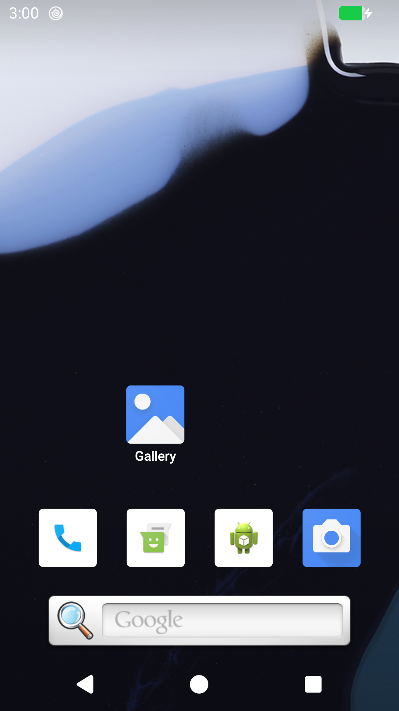
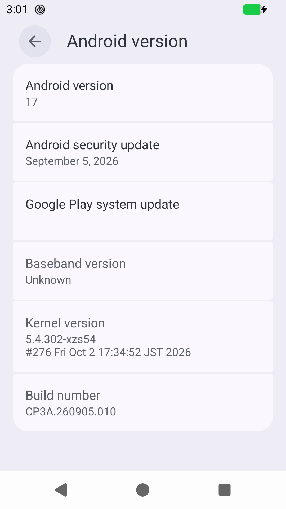
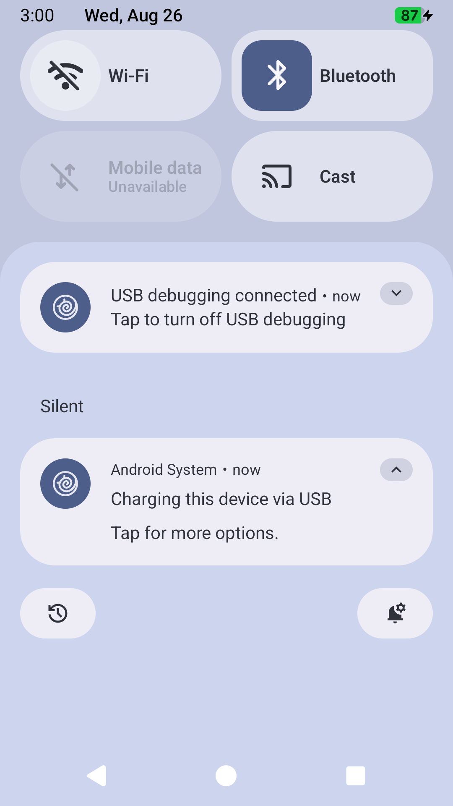

# Sony Xperia XZs (`keyaki` / `SO-03J`) — Bản Port Android 17 AOSP

**Ngôn ngữ / Language**: [English (Default - README.md)](README.md) | **Tiếng Việt**

Dự án port **Android 17 AOSP thuần ("Cinnamon Bun", `CP3A.260905.010`, SDK 37 / API 37.1)**, tích hợp kernel Linux 5.4 và bộ công cụ đóng gói image tái tạo 100% dành cho **Sony Xperia XZs (`SO-03J` / `keyaki`, Qualcomm Snapdragon 820 `MSM8996`, nền tảng Sony `tone`)**.

> [!IMPORTANT]
> **Cột mốc Baseline đã đóng băng (`v0.1.0-android17-boot-freeze`)**: Thiết bị đã cold boot độc lập từ bộ nhớ trong eMMC vào màn hình chính Android 17 Launcher3 trong ~38 giây (`sys.boot_completed=1`, `0` crash hệ thống), với GPU Adreno 530 tăng tốc phần cứng (`1080x1920 @ 60 Hz`), cảm ứng đa điểm, Wi-Fi, âm thanh loa kép stereo, cảm biến, bộ nhớ trong và USB ADB hoạt động ổn định trên phần cứng thực tế.

---

## Hình Chụp Màn Hình Thực Tế Trên Thiết Bị

| Màn hình chính Launcher3 | Thông tin phiên bản Android 17 | Thanh Quick Settings |
| :---: | :---: | :---: |
|  |  |  |

---

## Tổng Quan Kiến Trúc Hệ Thống

| Tầng hệ thống | Phiên bản / Nguồn | Phân vùng đích | Tóm tắt kỹ thuật |
| :--- | :--- | :--- | :--- |
| **System (`/` / `/system`)** | Google Android 17 AOSP ARM64 GSI (`CP3A.260905.010`, SDK `37`, Bản vá bảo mật `2026-09-05`, Vanilla / Không GMS) | `system` (`mmcblk0p55`, `7.18 GiB`) | Mở rộng ext4 `2.6 GiB`, unshare blocks, tích hợp `com.android.vndk.v30.apex` đã ký, chuyển đổi `com.android.virt.apex` sang ext4, sinh bảng ánh xạ SELinux `30.0.cil`, bản vá BPF Linux 5.4 và `libui` Gralloc 2.0 |
| **Vendor (`/vendor`)** | LineageOS 18.1 Treble Vendor (`tone` / `keyaki`, VNDK `30`, VINTF level `5`) | `oem` (`mmcblk0p53`, `400 MiB`) | Mount trực tiếp vào `/vendor` từ giai đoạn First-Stage Init; tích hợp 17 module âm thanh DLKM `5.4.302`, firmware/NVRAM Wi-Fi PCIe `brcmfmac`, USB ConfigFS và `fstab.keyaki` hỗ trợ `fsverity` |
| **Kernel & Boot** | Linux `5.4.302-xzs54` (`nec093/sov35-kernel`) + trình khởi tạo tĩnh `keyaki_first_stage_init` | `boot` (`mmcblk0p30`, `64 MiB`) | Đính kèm `msm8996-tone-keyaki` DTB, header v0 tương thích `S1_Boot` (`--os_version 10.0.0`), tạo sớm block node eMMC/RPMB, `SwitchRoot` sang `/system/bin/init` |
| **Recovery độc lập** | TWRP `3.18.71` | `FOTAKernel` (`mmcblk0p48`, `64 MiB`) | Giữ nguyên không ghi đè để làm môi trường cứu hộ độc lập (`adb reboot recovery` hoặc `Nguồn + Giảm âm lượng`) |

---

## Bảng Trạng Thái Phần Cứng Và Tính Năng

### Đã Hoạt Động (Đã kiểm chứng trên thiết bị `SO-03J` thực tế)

| Phân hệ | Trạng thái | Chi tiết kỹ thuật |
| :--- | :--- | :--- |
| **Khởi động & Hệ điều hành lõi** | `[Working]` | Cold boot độc lập từ eMMC `mmcblk0` trong ~38 giây (`sys.boot_completed=1`), 45/45 gói APEX được kích hoạt và xác thực bởi `PackageManagerService`, Zygote64, ART, SystemUI, Launcher3 |
| **Màn hình & Đèn nền** | `[Working]` | Tấm nền IPS MIPI-DSI `1080x1920 @ 60 Hz` (`mdss_dsi_panel`), ngắt VSYNC phần cứng ổn định, điều khiển độ sáng WLED / `lcd-backlight` |
| **GPU & Kết xuất đồ họa** | `[Working]` | Qualcomm Adreno 530 (`OpenGL ES 3.2 V@415.0`), `Gralloc 2.0` (`allocator@2.0` / `mapper@2.0`), `HWComposer 2.1` kết xuất lớp phủ phần cứng (`DEVICE`), `skiaglthreaded` RenderEngine |
| **Cảm ứng & Phím vật lý** | `[Working]` | Cảm ứng đa điểm Synaptics `clearpad` (`/dev/input/event5`), phím Nguồn (`qpnp_pon`), Tăng/Giảm âm lượng và phím Chụp ảnh 2 nấc (`gpio-keys`) |
| **Wi-Fi (`802.11a/b/g/n/ac`)** | `[Working]` | Broadcom `BCM4359` PCIe (driver `brcmfmac` + NVRAM `somc,keyaki` + `android.hardware.wifi@1.0-service` / `IWifi@1.4` + `wpa_supplicant`); giao diện `wlan0` bật và quét mạng 2.4/5 GHz thành công |
| **Âm thanh (Loa kép Stereo)** | `[Working]` | Sound card `msm8996-tasha-mtp-snd-card` (`wcd9335` codec + 2 khuếch đại loa stereo `wsa881x` qua 17 module DLKM `5.4.302` + `AudioFlinger` 48 kHz stereo mixer) |
| **Bộ nhớ trong & Swap** | `[Working]` | `/data` (`mmcblk0p54`, ~20.8 GiB `ext4` đọc/ghi kèm `quota` + `fsverity`), `/cache` (`mmcblk0p43`, 256 MiB `ext4`), `1 GiB` `zram0` swap |
| **Cảm biến (Sensors)** | `[Working]` | Gia tốc & Con quay Bosch `BMI160`, Từ kế AKM `AK09915`, Tiệm cận & Ánh sáng Avago `APDS-9940`, Áp kế ALPS `HSPPAD042A`, Gia tốc tuyến tính & Trọng lực QTI |
| **USB & ADB** | `[Working]` | Bộ điều khiển Qualcomm DWC3 peripheral (`6a00000.dwc3`), ConfigFS FunctionFS ADB (`0x18D1:0x4EE7`) |
| **Pin, Sạc & Quản lý năng lượng** | `[Working]` | Báo cáo phần trăm pin, điện áp, nhiệt độ (`android.hardware.health@2.1`), nhận sạc USB, điều tốc CPU `vendor.qti.hardware.perf@2.0-service` |
| **Bảo mật phần cứng, DRM & TA** | `[Working]` | `qseecomd` + `/dev/mmcblk0rpmb`, `keymaster@3.0`, `gatekeeper@1.0`, Sony Trim Area (`tad_static` + `ta_qmi_service`), `drm@1.0` / `widevine@1.2` / `clearkey@1.3`, rung `vibrator@1.0-service` |

### Một Phần / Chưa Kiểm Thử Vật Lý

| Phân hệ | Trạng thái | Ghi chú hiện tại |
| :--- | :--- | :--- |
| **GPS / Định vị GNSS** | `[Partial / Untested]` | Dịch vụ `android.hardware.gnss@2.0-service-qti` đang chạy và provider `gps` đã đăng ký trong `LocationManagerService`; chưa thử bắt tín hiệu vệ tinh ngoài trời |
| **NFC / FeliCa** | `[Partial / Untested]` | `android.hardware.nfc@1.1-service` và `com.android.nfc` khởi động sạch (`I2C`); chưa kiểm thử quét thẻ NFC/FeliCa vật lý |
| **Cảm biến vân tay** | `[Partial / Untested]` | `android.hardware.biometrics.fingerprint@2.1-service.sony` và ngắt `irq/159-soc:fpc` hoạt động; chưa kiểm thử đăng ký vân tay trong Android 17 `BiometricService` |
| **Thẻ nhớ MicroSD & USB OTG** | `[Partial / Untested]` | Đã khai báo đầy đủ `vold` trong `fstab.keyaki` (`74a4900.sdhci` và `6a00000.dwc3`); chưa cắm thẻ nhớ vật lý trong quá trình kiểm thử |
| **Đèn LED thông báo RGB** | `[Partial / Untested]` | Các node `/sys/class/leds/led:rgb_{red,green,blue}` trên kernel hoạt động; chưa kiểm thử ánh xạ thông báo của framework Android 17 |

### Chưa Hoạt Động / Lỗi Đã Biết (Kế hoạch Giai đoạn 2)

| Phân hệ | Trạng thái | Nguyên nhân gốc & Hướng xử lý |
| :--- | :--- | :--- |
| **Bluetooth** | `[Not Working]` | `android.hardware.bluetooth@1.0-service` nạp firmware `BCM4359C0.hcd` và bật chip thành công, nhưng `com.android.bluetooth` (`BluetoothSystemServer` / GD stack của Android 17) tự động thoát sau ~6 giây do thiếu tính năng HCI trên chip cũ. Hiện giữ Bluetooth tắt (`svc bluetooth disable`) cho đến khi bổ sung shim HAL |
| **Camera & Đèn Flash** | `[Not Working]` | `cameraserver` hiện báo `0` camera; ngăn xếp `camera.provider@2.4` và blob Sony trên MSM8996 cần được port và viết shim cho Linux 5.4 + Android 17 |
| **Mạng di động / RIL / SIM** | `[Not Working]` | Chủ động vô hiệu hóa (`modem.mdt` được bind-mount vào `/dev/null` trong `configs/init/init.keyaki.rc`) do máy thử nghiệm đang chạy firmware baseband Nougat cũ (`LA2.0_N_117`) gây xung đột IPA/SSR trên Linux 5.4. Cần nâng cấp phân vùng baseband lên Oreo (`41.3.A.2.192`) và cập nhật Radio HAL |
| **SELinux Enforcing** | `[Not Working]` | Kernel hiện chạy ở chế độ permissive thông qua bind-mount `/dev/.selinux_enforce_shadow` ở giai đoạn first-stage để các daemon vendor MSM8996 khởi động đầy đủ; sẽ bổ sung rule sepolicy để bật enforcing ở giai đoạn sau |
| **Giải mã Video phần cứng & Vulkan UI** | `[Not Working]` | Giao diện dùng OpenGL ES 3.2 (`ro.hwui.use_vulkan=false`, `skiaglthreaded`); giải mã video dùng `com.android.media.swcodec` (phần mềm) do OMX cũ đã bị loại bỏ trên Android 17 và `Codec2` phần cứng MSM8996 chưa được kết nối |

---

## Cấu Trúc Thư Mục Repository

Xem sơ đồ chi tiết trong [README.md (English)](README.md#repository-structure). Toàn bộ tệp nhị phân dung lượng lớn (`.img`, `.zip`, `.apex`), bản sao lưu nhạy cảm (`backup/`) và thư mục tạm (`work/`, `out/`) đều được loại trừ an toàn qua `.gitignore`.

---

## Hướng Dẫn Tái Tạo Bản Build (Reproducible Build)

### 1. Chuẩn bị dữ liệu nguồn tại máy cục bộ
Đặt các thành phần nguồn vào thư mục làm việc cục bộ (mã commit và SHA-256 chính xác xem tại [`manifests/sources.json`](manifests/sources.json)):
- `port_rom/extracted/system.img`: Giải nén từ Google Android 17 ARM64 GSI (`aosp17_arm64_CP3A.zip`).
- `backup/oem.img`: Ảnh phân vùng vendor LineageOS 18.1 `tone`/`keyaki` (`400 MiB`).
- `base_rom/`: Mã nguồn `nec093/sov35-vendor` (`device-keyaki`, `device-tone-common`), firmware `brcmfmac4359-pcie.{bin,txt}`, và gói `vndk30_and_vintf.tar` trích xuất từ LineageOS 18.1.
- `prebuilt/Image.gz-dtb`: Ảnh kernel Linux `5.4.302-xzs54` đã xác thực trên `S1_Boot` (cùng `out/kernel_a17/modules/*.ko` biên dịch bằng `tools/build_kernel_a17.sh`).

### 2. Chạy quy trình đóng gói trong Container Ubuntu 22.04 `aarch64`

```bash
docker run -d --privileged --name xzs17-box -v "$(pwd):/work" ubuntu:22.04 sleep infinity
docker exec xzs17-box bash -c "apt-get update && apt-get install -y python3 e2fsprogs android-sdk-libsparse-utils erofs-utils apksigner openssl gcc-aarch64-linux-gnu binutils-aarch64-linux-gnu attr unzip bc bison flex libssl-dev make git rsync"

# 1. Tạo ảnh phân vùng Vendor (/vendor -> out/oem-a17-keyaki.img & out/oem-a17-keyaki.sparse.img)
docker exec xzs17-box bash /work/tools/build_vendor_oem.sh

# 2. Tạo và kiểm tra offline ảnh System & Boot (out/system-a17-keyaki.sparse.img & out/boot-a17-keyaki.img)
docker exec xzs17-box python3 /work/tools/build_system_and_boot_a17.py
```

---

## Hướng Dẫn Flash Qua Fastboot

> [!WARNING]
> **Sao Lưu Phân Vùng Quan Trọng Trước Khi Flash**: Trước khi ghi bất kỳ dữ liệu nào lên Xperia XZs, hãy vào TWRP sao lưu `TA` (`mmcblk0p1`), `FOTAKernel` (`mmcblk0p48`), `boot` (`mmcblk0p30`), `oem` (`mmcblk0p53`), `modemst1`, `modemst2`, và `fsg` ra máy tính (`backup/`). **Tuyệt đối không** flash đè lên `TA`, `aboot`, `modemst*`, hoặc `FOTAKernel`. Xem chi tiết tại [`docs/PARTITION_LAYOUT.md`](docs/PARTITION_LAYOUT.md) và [`docs/REBOOT_AND_RECOVERY.md`](docs/REBOOT_AND_RECOVERY.md).

1. Tắt nguồn điện thoại hoàn toàn. Nhấn giữ **Tăng âm lượng (Volume Up)** và cắm cáp USB để vào **Fastboot** (đèn LED xanh dương).
2. Nạp lần lượt Vendor (`oem`), System (`system`) và Boot (`boot`):
   ```bash
   fastboot flash oem out/oem-a17-keyaki.sparse.img
   fastboot flash system out/system-a17-keyaki.sparse.img
   fastboot flash boot out/boot-a17-keyaki.img
   ```
3. Nếu chuyển từ phiên bản Android cũ sang, hãy format `/data` và `/cache` sang `ext4` trong TWRP (`FOTAKernel`) một lần trước khi khởi động.
4. Khởi động vào Android 17:
   ```bash
   fastboot reboot
   ```

---

## Danh Mục Tài Liệu Kỹ Thuật

- **Hướng dẫn Kỹ thuật Port Android 17 (10 Nguyên nhân gốc & Giải pháp)**: [English](docs/ANDROID17_PORT_GUIDE.md) | [Tiếng Việt](docs/ANDROID17_PORT_GUIDE.vi.md)
- **Sơ đồ Phân vùng eMMC & Quy tắc An toàn**: [`docs/PARTITION_LAYOUT.md`](docs/PARTITION_LAYOUT.md)
- **Cơ chế Khởi động `S1_Boot` & Phục hồi TWRP**: [`docs/REBOOT_AND_RECOVERY.md`](docs/REBOOT_AND_RECOVERY.md)
- **Quy tắc Dự án & Đóng góp**: [`AGENTS.md`](AGENTS.md)
- **Danh mục Mã nguồn & Mã băm SHA-256**: [`manifests/sources.json`](manifests/sources.json)
